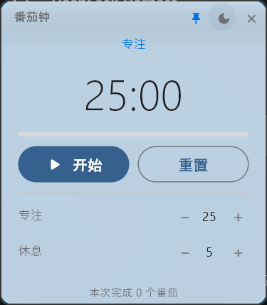
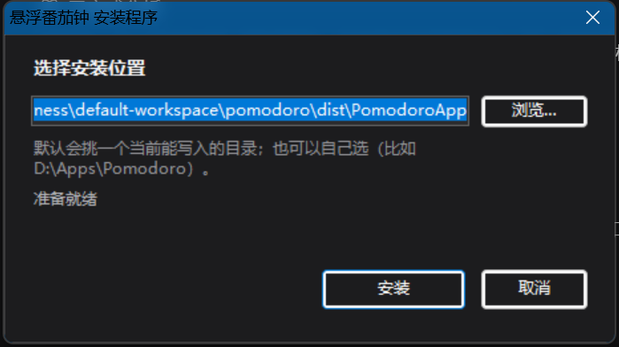

# 悬浮番茄钟 · Floating Pomodoro

> 仓库地址：https://github.com/5y2znfz2df-del/floating-pomodoro

一个常驻桌面、**始终置顶、可以随便拖到屏幕任意角落**的小番茄钟。
界面走「液态玻璃」——半透明 + 系统级毛玻璃模糊 + 圆角；闲置 5 秒自动收进**离它最近的那条屏幕边缘**，
只留一条圆角小黑条，点一下再展开（滑动过程是 ease-out 缓动，15 帧）。




收起后贴在屏幕边缘的样子（窗口在右边就贴右，在左边就贴左）：


---

## 特性

| 功能 | 说明 |
| --- | --- |
| 液态玻璃 | 页面透明 + Windows DWM 亚克力模糊，透出背后桌面；1px 高光描边 + 顶部渐变反光 |
| 悬浮置顶 | 无边框小窗（250×286），始终压在其他窗口上方；可随时取消置顶 |
| 自由拖动 | 按住顶部标题栏任意位置拖动（`WindowDragArea`） |
| 就近收起 | **5 秒**没操作，自动缩到**最近的一侧**（左半屏贴左、右半屏贴右），纵向位置不变；点小黑条展开并回到原位 |
| 专注 / 休息 | 默认 25 + 5 分钟，可在 1–120 / 1–60 分钟内调节 |
| 结束提醒 | 专注结束上扬三音，休息结束两个短音（Windows 系统 beep，不需要音频文件） |
| 深浅色 | 一键切换，两套玻璃配色整体替换 |
| 任务栏进度 | 运行时任务栏图标显示倒计时进度 |
| 自动回到前台 | 专注结束时把窗口提到最前，怕你忘 |
| 一键安装 | 提供单文件安装程序：双击 → 装到用户目录 → 桌面和开始菜单自动建快捷方式 |
| 完全离线 | 不联网、不上传、不写注册表、不收集任何数据 |

---

## 环境要求

- Windows 10 / 11
- Python 3.9+（开发与测试使用 3.12.10）

> **为什么锁 `flet==0.28.3`**
> Flet 从 1.0 开始，桌面客户端不在 wheel 里了，改成首次运行时从 GitHub Releases
> 下载。0.28.3 把 `flet.exe` 和 Flutter 运行时直接打进 wheel，真正做到装完即用、
> 全程不需要联网。这对本项目「完全本地运行」的要求是必需的。

---

## 运行

```powershell
# 1. 建虚拟环境
python -m venv .venv
.\.venv\Scripts\activate

# 2. 装依赖
pip install -r requirements.txt

# 3. 启动
python app.py
```

窗口出现在屏幕左上角，250×286（逻辑像素）。

---

## 打包成 exe

```powershell
flet pack app.py `
  --name Pomodoro `
  --icon assets/icon.ico `
  --product-name "悬浮番茄钟" `
  --company-name "XiangFu" `
  --product-version 1.0.0 `
  --file-version 1.0.0.0 `
  --copyright "MIT License" `
  -D
```

产物在 `dist\Pomodoro\Pomodoro.exe`，**整个 `Pomodoro` 文件夹一起分发**（双击文件夹里的 exe 即可）。

### 为什么默认用 `-D`（目录模式）而不是单文件

单文件模式（不加 `-D`）每次启动都要先把 192 MB 的自己解压到 `%TEMP%\_MEIxxxx`，
这一步在实际机器上踩过两个坑：

| 坑 | 现象 | 目录模式 |
| --- | --- | --- |
| 安全软件拦截建临时目录 | 弹窗 **Could not create temporary directory!** | 不受影响，启动时不解压 |
| 临时目录 ACL 受限 | 同上，或启动后立刻退出 | 不受影响 |
| 冷启动慢 | 每次 3–8 秒 | 接近秒开 |

所以除非必须单文件分发，一律建议 `-D`。

### 其它打包参数

- **看报错**：加 `--debug-console debug`，exe 会带一个控制台窗口，出问题能直接看到堆栈。
- **换输出目录**：`--distpath D:\apps`。
- **非交互环境**：打包会问一次「是否删除 build 目录」，脚本/CI 里加 `-y` 跳过。

### 关于产物的两个事实

| 项目 | 说明 |
| --- | --- |
| 体积 | 目录模式整体约 **203 MB**（exe 本体 10.7 MB + `_internal` 依赖） |
| 杀毒误报 | PyInstaller 产物被启发式引擎误判很常见，加白名单即可 |

打包生成的 `Pomodoro.spec`、`build\` 都可以删，重新打包会自动生成。

---

## 生成安装包（单个 exe）

```powershell
powershell -ExecutionPolicy Bypass -File installer\build-installer.ps1
```

产物：`dist\Pomodoro-Setup.exe`（约 90 MB）——**就一个文件**，双击即装。



它做的事：

1. **让你选安装位置**（默认自动挑一个能写的目录，也可以点「浏览…」自选）
2. 解压到目标目录，不需要管理员权限
3. 在**桌面**和**开始菜单**建「悬浮番茄钟」快捷方式
4. 在开始菜单建「卸载」
5. 装完直接启动程序

### 为什么不用 Inno Setup / NSIS

这台机器访问不了 GitHub（Inno Setup 的下载全在 GitHub Releases 上），本机也没装 NSIS。
所以用 **Windows 自带的 C# 编译器**（`csc.exe`）编译了一个自解压安装程序：

- 应用目录压成 `payload.zip`（~90 MB），作为**嵌入资源**塞进 exe
- 运行时直接解压到目标目录，**不经过 `%TEMP%`** —— 正好绕开单文件模式那个
  `Could not create temporary directory!` 的坑
- 界面是一个小窗口 + 进度条，全程不联网

### 静默安装 / 自定义目录

```powershell
# 图形界面：可以自己选目录（点「浏览…」）
.\dist\Pomodoro-Setup.exe

# 无界面安装，自动挑一个可写的目录
.\dist\Pomodoro-Setup.exe --silent

# 无界面安装到指定目录（绿色安装）
.\dist\Pomodoro-Setup.exe --silent --dir "D:\Apps\Pomodoro"
```

安装失败时详细报错会写进 `%LOCALAPPDATA%\Pomodoro-Setup.log`（写不了会退到安装包所在目录或 `%TEMP%`）。

---

## 操作说明

| 操作 | 效果 |
| --- | --- |
| 按住标题栏拖动 | 移动窗口 |
| 📌 图标 | 切换「始终置顶」 |
| ☀ / 🌙 图标 | 切换深色 / 浅色 |
| ✕ 图标 | 关闭程序 |
| 开始 / 暂停 | 启动或暂停当前阶段倒计时 |
| 重置 | 回到当前阶段的起点 |
| − / ＋ | 调整专注或休息时长（运行中锁定，避免中途改动） |
| 点屏幕边缘的小黑条 | 从收起状态展开 |

**就近收起**：5 秒内没有任何操作（点击、悬停、改时长都算），窗口会缩进**离它最近的那条屏幕边缘**：

- 窗口中心在屏幕**左半** → 贴左边
- 窗口中心在屏幕**右半** → 贴右边
- **纵向位置不动**（窗口在 `(3, 5)`，收起后仍在 `y=5` 那条线上）

只留一条 10 px 宽的圆角小黑条。点它立刻展开，并回到收起前的精确位置。

### 动画是怎么做的

窗口级动画没有现成的 `animate` 属性，所以是**逐帧改窗口坐标 + `page.update()`**：

- 横向位置走 **ease-out-cubic** 缓动（`ease_out_cubic()`，起步快、收尾慢），实测 12 帧、约 440 ms
- 面板同时淡出（`animate_opacity`），避开内容被生硬裁切
- 高度不参与动画：Flet 改窗口高度时**以垂直中心为基准**，边滑边压扁会把纵向位置拽走，
  所以高度留到窗口只剩一条缝时再切
- 每帧都要顺带把 `top` 一起写上，否则 Flet 单独改 `left` 会把纵向位置重置成默认值

一轮结束后自动切到另一个阶段，按「开始」进入下一轮；底部显示本次运行完成了几轮专注。

---

## 项目结构

```
pomodoro/
├─ app.py                    主程序（界面与逻辑，含中文注释）
├─ win_effects.py            Windows 原生特效：去标题栏、亚克力模糊、圆角
├─ requirements.txt          依赖（flet 0.28.3 + pyinstaller）
├─ assets/
│  ├─ icon.ico               应用图标（多分辨率）
│  └─ icon-preview.png       图标预览
├─ installer/
│  ├─ Installer.cs           安装程序源码（C#，自带进度条）
│  └─ build-installer.ps1    编译成单文件 exe
├─ docs/                     截图
├─ tests/
│  └─ test_logic.py          纯逻辑单元测试（无需图形环境）
├─ tools/
│  ├─ make_icon.py           重新生成图标
│  ├─ wheelinstall.py        绕开 pip 的最小 wheel 安装器（可选，见下）
│  ├─ capture_by_title.ps1   按标题截图，验证界面用
│  └─ smoke_test.py          以 Web 模式跑同一份 UI，便于无桌面环境验证
├─ dist/                     构建产物
│  ├─ Pomodoro-Setup.exe     ← 单文件安装程序（分发这个）
│  └─ Pomodoro/              绿色版目录（解压即用）
├─ LICENSE                   MIT
└─ README.md
```

### 玻璃效果是怎么做的

Flet 本身没有「背景模糊」的能力，所以分了三层：

1. `page.bgcolor` 设成透明，让窗口的空白处透出桌面；
2. `win_effects.py` 用 `SetWindowCompositionAttribute` 挂上**亚克力模糊**（Win10 1803+ / Win11）；
3. 再补一圈 1px 半透明描边 + 顶部渐变反光，就有了玻璃的「厚度感」。

另外 `frameless` 在部分环境里不会真正生效（窗口仍带 `WS_CAPTION`），一旦背景透明，
系统的最小化/最大化/关闭按钮就会露出来——所以 `win_effects.py` 还会从 Win32 层
把标题栏样式摘掉。这些调用全部是「尽力而为」：失败就静默退回普通不透明窗口，不会崩。

---

## 测试

```powershell
python tests\test_logic.py
```

覆盖时间格式化、区间夹取、阶段切换、进度计算共 20 项断言，不依赖 GUI。

`tools\smoke_test.py` 会用同一份 `app.py` 起一个本地 Web 版本（默认 8550 端口），
适合在没有可见桌面的环境里检查控件树能不能正常构建。

---

## 常见问题

**双击 exe 弹出 `Could not create temporary directory!`**
这是**单文件模式**的典型故障：它启动时要往 `%TEMP%` 里解压自己，被安全软件（火绒、Defender 等）
或临时目录权限拦住了。解决办法：改用 `-D` 目录模式重新打包，或者把 exe 加进安全软件白名单。

**安装时报「访问被拒绝」（对路径 `%LOCALAPPDATA%\Programs\Pomodoro` 的访问被拒绝）**
从 v1.0.2 起安装程序会**自动换目录重试**，依次尝试：

```
%LOCALAPPDATA%\Programs\Pomodoro
%LOCALAPPDATA%\Pomodoro
%APPDATA%\Pomodoro
%USERPROFILE%\Pomodoro
安装包所在目录\PomodoroApp
```

判定标准是「真的能建目录并写入文件」，所以哪怕 `Programs` 被锁住也会自动落到下一个。
快捷方式始终指向实际安装到的位置。

如果**全都**写不进去，会弹出完整清单。此时可以：

1. 打开安全软件的拦截记录，允许一次再装；
2. 用 `installer\portable-install.cmd`（或 dist 里的 `一键安装.cmd`）—— 走 cmd + PowerShell 复制文件；
3. 干脆不装：直接双击 `Pomodoro\Pomodoro.exe`，绿色版不需要任何写入。

安装日志会依次尝试写到 `%LOCALAPPDATA%`、安装包所在目录、`%TEMP%`，文件名为 `Pomodoro-Setup.log`。

**双击 exe 闪一下就没了**
用 `flet pack ... --debug-console debug` 重新打包，看控制台输出。多数是杀毒软件拦截或缺少 VC 运行库。

**被杀毒软件报毒**
PyInstaller 打出来的单文件 exe 常被启发式引擎误判，这属于打包工具的普遍问题，不是代码行为。加信任白名单，或改用 `-D` 目录模式分发。

**没有提示音**
`winsound.Beep` 走的是系统扬声器音量，静音或音量调到 0 时不会响。笔记本插耳机时也会从耳机出。

**玻璃效果没出来 / 窗口是不透明的一块**
亚克力模糊需要 Windows 10 1803+ 或 Windows 11。老系统或远程桌面会话里可能被禁用，
此时程序会自动退回不透明的普通窗口，功能不受影响。可以看启动日志里 `glass = {...}` 那一行：
`acrylic: True` 表示毛玻璃挂上了。

**窗口标题栏按钮冒出来了**
这是 `frameless` 没生效。`win_effects.make_frameless()` 会从 Win32 层再摘一次；
如果仍然出现，说明当前环境的窗口样式被别的程序改写了（某些窗口美化工具会这么做）。

**收起后的小黑条点不到**
黑条只有 10 像素宽，贴着屏幕右边缘。如果开了任务栏自动隐藏或者有别的置顶窗口，
可能被盖住。调大 `app.py` 里的 `STRIP_VISIBLE` 即可加宽。

**置顶对某些全屏游戏无效**
Windows 上全屏独占（exclusive fullscreen）会抢走置顶层，这是系统限制。把游戏改成「无边框窗口」模式即可保持置顶。

**窗口位置不记忆**
当前版本不落盘任何配置，关掉就回到左上角，保证「零痕迹」。要记住位置可以自己接一个 json 文件。

**能不能在 macOS / Linux 跑**
界面和计时逻辑是跨平台的，但玻璃效果和去标题栏依赖 Windows API；
在非 Windows 上 `win_effects` 所有函数都返回 `False`，程序会以普通窗口运行。

---

## 隐私

- 没有网络请求，没有遥测，没有崩溃上报。
- 不读取、不写入任何用户文件；不落盘配置。
- 提示音由系统 API 在本地合成，不加载外部音频资源。

---

## 关于 `tools/wheelinstall.py`

这个脚本是为了一台特殊机器写的：那台机器上 pip 装不了包（父目录有一条
`Everyone Deny DeleteSubdirectoriesAndFiles` 的 ACL，pip 无法重命名自己的临时文件）。
它自己解析依赖、用 zipfile 解包，只创建文件、不删除文件。

**正常机器不需要它**，直接 `pip install -r requirements.txt` 就行。

---

## 许可证

[MIT](LICENSE) © 2026 XiangFu

---

## 已验证环境

开发与验证都在 Windows 11 + Python 3.12.10 + flet 0.28.3 上完成，实际确认过：

- 窗口以 250×286（逻辑像素）无边框、置顶的方式创建并渲染，系统标题栏被成功摘除
- 亚克力模糊生效：截图能透出并模糊化背后的桌面内容
- 点「开始」后倒计时从 25:00 正常递减，按钮变为「暂停」，进度条同步推进
- 点太阳/月亮图标能切换深色 ↔ 浅色，两套玻璃配色都验证过
- **就近收起**：窗口在左半边（60, 200）→ 收进左边缘且 `y` 保持 200；在右半边（1400, 300）→ 收进右边缘且 `y` 保持 300；点黑条展开回到原位
- **收起动画**：实测轨迹 `400 → 267 → 150 → -39 → … → -355 → -358 → -360`，12 帧 ease-out，
  全程纵向坐标稳定不漂移，收尾高度切到 144
- `flet pack -D` 产出的 `dist\Pomodoro\Pomodoro.exe` 与安装程序装出来的程序都能正常启动，界面与源码运行一致
- 安装程序的**解压环节**已实测：841 个条目 → 826 个文件 / 203 MB，全部到位，装出来的程序能启动
- `tests\test_logic.py` 的 20 项断言全部通过

未能在本机完整验证的部分（环境限制，非代码问题）：

- 安装程序的**快捷方式创建**没跑通：本机开发沙箱给 .NET 子进程套了受限令牌，
  连一个「建目录」的 20 行测试程序都会被拒绝；同样的操作从 PowerShell 里做是成功的。
  在正常桌面环境下双击运行不受此限制。
- 多显示器混合 DPI、macOS/Linux、全屏独占游戏下的置顶行为、Windows 10 上的亚克力表现。
