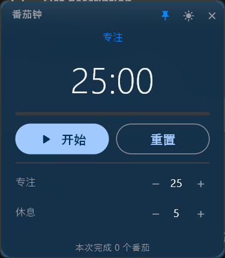

# flet-win-effects

**A minimal Flet recipe for acrylic glass + frameless + edge-snap animation on Windows.**
**给 Flet 的 Windows 窗口加亚克力毛玻璃、无边框和贴边动画的最小方案。**

<!--
  TODO 录一段 demo.gif 放进 docs/，然后取消下面这行注释。
  录什么：
    1) 窗口半透明，背后桌面被模糊
    2) 拖动窗口到屏幕左侧
    3) 松手 5 秒后自动贴到左边，只剩一条圆角小黑条
    4) 点小黑条，滑回原位并恢复玻璃面板
  建议：ScreenToGif / OBS，800×500，15fps，压缩到 3 MB 以内。
-->
<!--  -->

核心只有一个文件：[`flet_win_effects/__init__.py`](flet_win_effects/__init__.py)（234 行，纯 `ctypes`）。
不依赖 Flet，也不依赖任何第三方包；所有调用失败都静默返回 `False`，不会把程序搞崩。

---

## Quick start

把这段贴进任意 Flet 窗口，就有玻璃效果了：

```python
import asyncio, flet as ft
import flet_win_effects as fx

async def main(page: ft.Page):
    page.title = "My App"
    page.padding = 0
    page.bgcolor = ft.Colors.TRANSPARENT        # 让窗口空白处透出桌面
    page.window.frameless = True                # 先让 Flet 去掉标题栏

    page.add(ft.Container(
        expand=True,
        bgcolor="#9E1C1C1E",                    # AARRGGBB：半透明面板 = 玻璃本体
        border=ft.border.all(1, "#30FFFFFF"),   # 1px 高光描边
        border_radius=14,
    ))

    await asyncio.sleep(1.2)                    # 等窗口真正创建，太早拿不到句柄
    print(fx.apply_glass("My App"))             # 一行挂上：去边框 + 亚克力 + 圆角

ft.app(main)
```

复制这段到你的 Flet 项目即可。完整可运行版本（30 行、无任何业务逻辑）：
[`examples/minimal.py`](examples/minimal.py)。

`apply_glass()` 返回 `{'hwnd': 123, 'frameless': True, 'acrylic': True, 'rounded': True}`，
建议打进启动日志——排查问题时一眼就能看出是哪一步没成功。

## 安装

```powershell
pip install flet                       # 1. 只装 Flet，组件本身零依赖
Copy-Item flet_win_effects .\your_project\ -Recurse   # 2. 把包目录拷进项目
```

然后 `import flet_win_effects` 就能用。要跟着仓库改代码，用 `pip install -e .`。

---

## Demo：floating-pomodoro

这个仓库顺带放了一个完整用例——**悬浮番茄钟**：250×286 的无边框玻璃卡片，闲置 5 秒
贴到最近的一侧屏幕边缘（纵向位置不变），点小黑条滑回原位。



它用到了组件全部能力，另外自己实现了计时、深浅色和任务栏进度。
代码在 [`app.py`](app.py)，打包好的 89 MB 安装包在
[Releases](https://github.com/5y2znfz2df-del/floating-pomodoro/releases)。

**穿透模式**：点标题栏的 👆 图标，鼠标就完全穿过窗口，写代码/玩游戏不挡操作。
顶部固定留 3px 不穿透，悬停会亮一条细线，按住即可拖动窗口。
退出方式两种：窗口有焦点时按 `P`，或点开穿透前那个按钮（穿透时按钮自动隐藏）。

**锁定**：点 🔒 锁定后禁止拖动；此时若还在穿透模式，**只剩 P 键**能退出。

---

## 关于「未知发布者」提示

安装包**没有数字签名**，所以 Windows 第一次运行时会弹：

> Windows 已保护你的电脑 —— **未知发布者**

这不是病毒报告，只是"这个 exe 没有付费证书"的意思。个人项目买代码签名证书
（每年一两千到上万不等）成本太高，所以这里选择用别的方式把信任讲清楚。

### 校验哈希

| 文件 | SHA256 |
| --- | --- |
| `Pomodoro-Setup.exe`（安装版，93.9 MB） | `0a4eed7be057676215df93cc08e5d9b44787c37c8dbad0d2e60ff550ddbbd9b7` |
| `Pomodoro-1.0.2-win-x64.zip`（绿色版，89.2 MB） | `69b3fee26657daeceb63c3ae660386c9c2b055fddd104f83607262a66b4129eb` |

```powershell
Get-FileHash .\Pomodoro-Setup.exe -Algorithm SHA256
```

下载后对一遍，一致就说明文件完整、没被中间人替换。

### 用 winget 安装

```powershell
winget install XiangFu.FloatingPomodoro
```

winget 会校验官方清单里记录的哈希，装完还能 `winget upgrade` / `winget uninstall`。
（清单已提交到 [microsoft/winget-pkgs #458843](https://github.com/microsoft/winget-pkgs/pull/458843)，审核通过后可用。）

### 还是不想信任二进制

直接跑源码，一行都不用相信 exe：

```powershell
pip install -r requirements.txt
python app.py
```

这个程序**不联网、不写注册表、不读用户文件**，装完在任何时候删掉目录就等于卸载干净。

## How it works

## How it works

### 亚克力模糊

Flet 没有暴露背景模糊，Windows 也没给普通窗口提供「设个属性就毛玻璃」的接口。
能用的是 `user32!SetWindowCompositionAttribute`（未公开但长期稳定）：

```
ACCENT_POLICY {
    AccentState   = ACCENT_ENABLE_ACRYLICBLURBEHIND (4)
    AccentFlags   = 2
    GradientColor = (alpha << 24) | (b << 16) | (g << 8) | r   // 注意是 AABBGGRR
}
WINDOWCOMPOSITIONATTRIBDATA { Attrib = WCA_ACCENT_POLICY (19), pvData, cbData }
```

两个坑：

- **颜色字节序是 AABBGGRR**，不是常见的 RRGGBB，传错了会得到诡异的粉绿底。
- **Flutter 表面必须自己让出透明度**：`page.bgcolor = TRANSPARENT` 之后，
  合成器才会把亚克力层露出来；否则永远是纯色。

### 无边框

Flet 的 `Window.frameless = True` 在部分环境里**不会真正生效**——窗口样式里
`WS_CAPTION` 还在，只是被不透明背景盖住了。一旦背景透明，系统的最小化/最大化/关闭
三个按钮就会直接印在内容上方。

所以组件从 Win32 层再摘一次：

```python
style = GetWindowLongW(hwnd, GWL_STYLE)
SetWindowLongW(hwnd, GWL_STYLE, style & ~WS_CAPTION & ~WS_THICKFRAME)
SetWindowPos(hwnd, None, 0,0,0,0, SWP_FRAMECHANGED | SWP_NOMOVE | SWP_NOSIZE | ...)
```

`SWP_FRAMECHANGED` 必须带上，否则改动不会重排非客户区。

### 窗口圆角

`DwmSetWindowAttribute(hwnd, DWMWA_WINDOW_CORNER_PREFERENCE /*33*/, DWMWCP_ROUND /*2*/)`。
只有 Windows 11 有；Win10 上返回非 0，组件直接当失败处理。

> 这条路走不通时还有一个土办法：`SetWindowRgn(CreateRoundRectRgn(...))` 直接裁窗口。
> 本项目试过，**不推荐**——region 的坐标是物理像素，而本进程 DPI 不感知，
> 在 150% 缩放下会把窗口裁小一圈。

### 贴边动画

窗口级动画没有现成的 `animate` 属性，只能**逐帧改坐标 + `page.update()`**。
番茄钟里那段 `_animate_left()` 是这样的：

```python
for i in range(1, steps + 1):
    win.left = round(start + (end - start) * ease_out_cubic(i / steps))
    win.top = top          # 必须每帧一起写，见下
    page.update()
    await asyncio.sleep(delay)
```

三个必须知道的细节：

1. **缓动用 ease-out-cubic**（`1-(1-t)³`），起步快、收尾慢。线性移动看起来很机械。
2. **`top` 必须每帧一起写**。Flet 单独改 `left` 时会把纵向位置重置成默认值，
   表现就是滑动过程中窗口突然跳到屏幕顶部。
3. **高度不参与动画**。Flet 改 `window.height` 是**以垂直中心为基准**的，
   边滑边压扁会把窗口纵向位置拽走（实测漂了 145px，正好是高度差的一半）。
   正确做法是滑完再切高度——那时窗口只剩一条缝，看不出跳变。

实测 12 帧、约 440 ms，轨迹：`400 → 267 → 150 → -39 → … → -355 → -358 → -360`，
全程纵向坐标稳定。

---

## Known limitations

**远程桌面 / 虚拟机** — RDP 会话里 `SetWindowCompositionAttribute` 常常返回成功但看不到模糊，
或者直接失败。Windows 合成器的限制，无解。

**全屏独占游戏** — 会抢走置顶层，`always_on_top` 也失效。让游戏跑「无边框窗口」模式。

**Windows 10 及更早** — 亚克力需要 10 1803+，圆角只有 Win11 才有。不支持时窗口退回
**不透明**样式，但不会崩、不会白屏（所有调用都是 `try/except → False`）。

**不要把 `set_backdrop()` 和去边框一起用** — 给无边框窗口设 `DWMWA_SYSTEMBACKDROP_TYPE`
时，Windows 会顺手把原生标题栏画回来。想要玻璃质感用 `enable_acrylic()`。

**收起后的小黑条点不到** — 黑条只有 10 像素宽。如果任务栏自动隐藏或有别的置顶窗口盖住，
就会点不到。把 `app.py` 里的 `STRIP_VISIBLE` 调大即可。

**窗口位置不记忆** — demo 不落盘任何配置，关掉就回左上角。

**非 Windows** — `IS_WINDOWS` 为 `False`，所有函数返回 `False` / `None`，
Flet 部分照常运行（只是没有特效）。

**穿透模式下按 P 会弹输入法候选框** — `disable_ime()` 只能作用于本进程的窗口，
跨进程（Flet 的窗口属于 `flet.exe`）解除 IME 关联会静默失败。快捷键本身仍然生效，
只是中文输入法状态会顺带弹一下候选框。

**Flet 的 `on_keyboard_event` 收不到按键** — 桌面端只有在 Flutter 里有可聚焦控件时
才派发键盘事件，纯展示窗口点了空白处也不产生焦点。组件里没有绕这个的办法，
demo 用 `GetAsyncKeyState` 轮询 + `GetForegroundWindow` 限定前台窗口来替代。

---

## 项目结构

```
flet_win_effects/   组件本体（__init__.py + README.md）
examples/           minimal.py —— 30 行最小示例
app.py              番茄钟 demo（计时 / UI / 贴边动画）
installer/          单文件安装程序源码（C#）
docs/               PACKAGING.md + 截图
tests/              20 项纯逻辑断言，不依赖 GUI
```

**测试**：`python tests\test_logic.py` —— 覆盖时间格式化、区间夹取、阶段切换、进度计算。

**隐私**：组件只调 Win32 / DWM 接口读写窗口属性，**不联网、不写文件、不读用户数据**；
demo 的提示音由系统 API 在本地合成，不加载外部音频。

打包成 exe / 安装程序的全部细节见 [`docs/PACKAGING.md`](docs/PACKAGING.md)。

---

MIT License © 2026 XiangFu

**If this saves you time, a star helps.** ⭐
